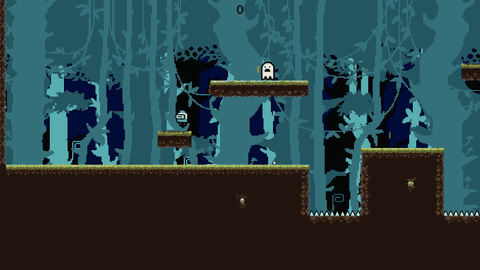
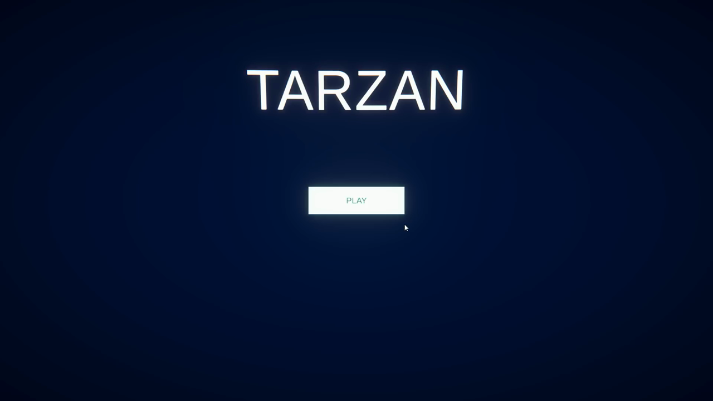
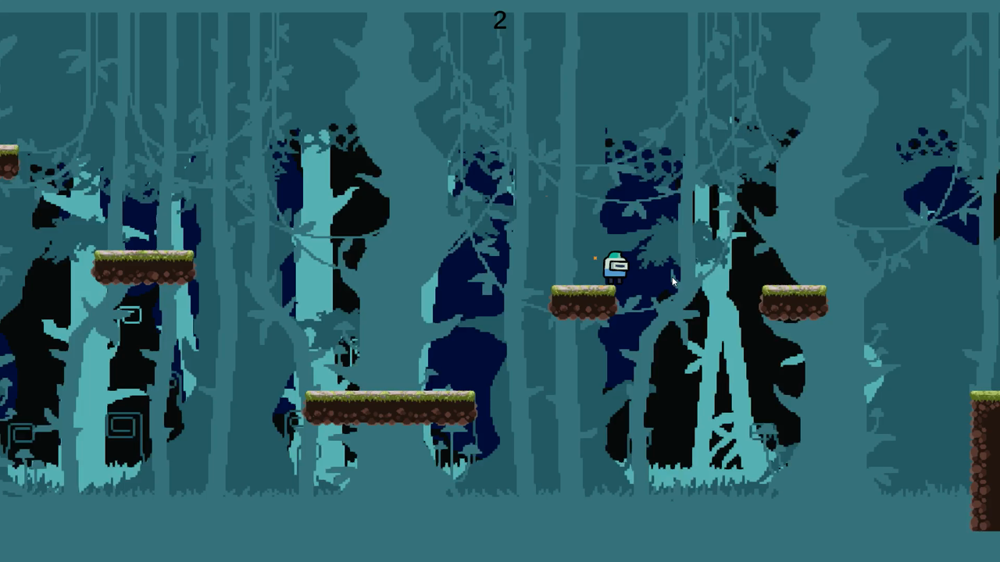
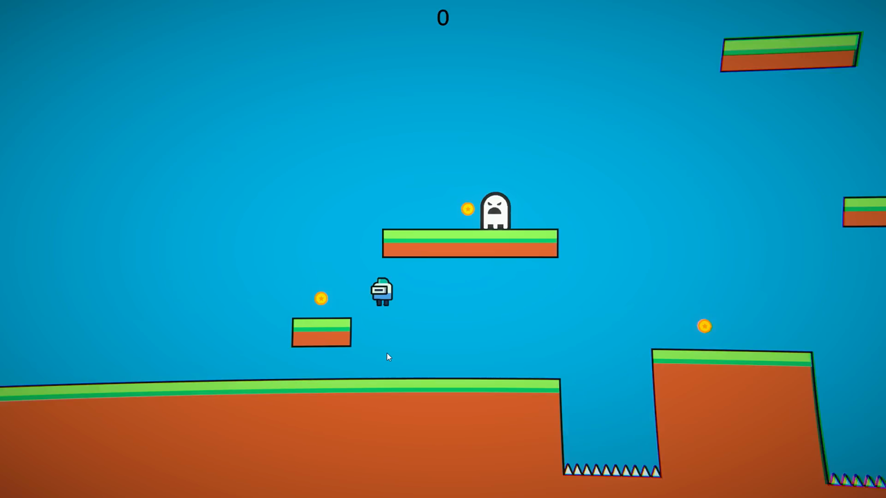
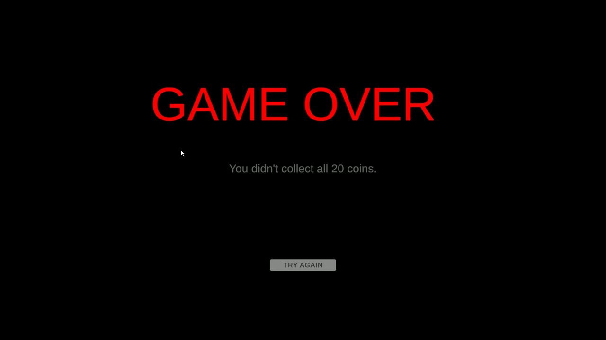

# Tarzan – 2D Platformer (Unity)

A 2D platformer built with **Unity** and **C#** as my undergraduate graduation thesis at Manisa Celal Bayar University, Software Engineering (advisor: Prof. Dr. Akın Özçift, 2025).

The player explores a single level, avoids enemies that patrol between two points and collects coins. Collecting **20 coins** wins the game; touching an enemy or falling onto spikes sends you to the *Game Over* screen.

**[⬇ Download the Windows build (v1.1)](https://github.com/aqcan/Tarzan-BitirmeTezi/releases/latest)**

## Screenshots

| Main menu | Level (v1.1) |
|---|---|
|  |  |
| **First prototype (v1.0)** | **Game over** |
|  |  |

## Features

- Player movement, jumping and run/idle animations using Unity 2D physics
- Enemies patrolling between Point A and Point B
- Coin collection with an on-screen counter and a 20-coin win condition
- Parallax scrolling background
- Menu, game, retry and finish scenes

## Controls

| Key | Action |
|---|---|
| `A` / `D` or arrow keys | Move left / right |
| `Space` | Jump |

## Tech

Unity 2022.3.54f1 (URP 2D) · C# · TextMesh Pro

Scripts live in [`Assets/Scripts`](Assets/Scripts): `PlayerController`, `EnemyController`, `CoinSystem`, `Parallax`, `MainMenu`, `RetrySceneButton`, `QuitSceneButton`.

## Running from source

1. Install **Unity 2022.3.54f1** via Unity Hub.
2. Clone this repository and open it with *Add project from disk*.
3. Open `Assets/Scenes/Menu.unity` and press Play.

## Versions

- `v1.0` – first prototype (simple tile level)
- `v1.1` – final version with the forest tileset, parallax background and menus

---

**TR:** Manisa Celal Bayar Üniversitesi Yazılım Mühendisliği bitirme tezi kapsamında Unity ile geliştirdiğim 2D platform oyunu. Devriye gezen düşmanlardan kaçarak 20 coin toplamak gerekiyor. Windows sürümü [Releases](https://github.com/aqcan/Tarzan-BitirmeTezi/releases/latest) sayfasında.
